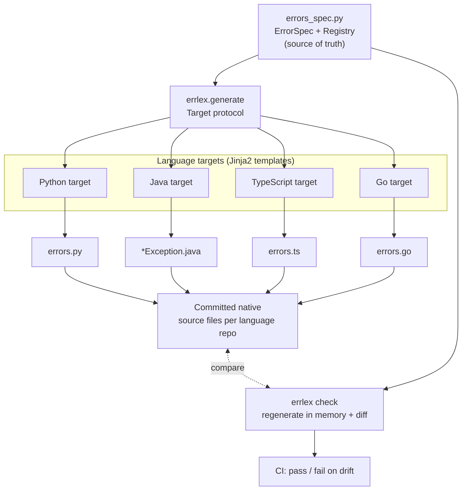

# errlex

**One error taxonomy, many languages.**

`errlex` is a single-source-of-truth error taxonomy generator for polyglot
systems. Define every error code once, in Python, and generate idiomatic native
error types for every language your services are written in. A CI-enforced drift
check makes sure the generated code and the specification never disagree.

## The problem

In a polyglot system, error codes are usually duplicated by hand: a string
constant in Python, an exception class in Java, an enum in TypeScript, an error
variable in Go. Nothing enforces that they stay in sync. When one side changes,
the other side finds out in production.

`errlex` treats error codes as a contract: one specification, many generated
artifacts, and a check that fails the build when they drift.

## Architecture

```
                       +-----------------------------+
                       |        errors_spec.py        |
                       |    ErrorSpec + Registry       |
                       |      (source of truth)        |
                       +---------------+---------------+
                                        |
                                        v
                       +-----------------------------+
                       |        errlex.generate        |
                       |      (Target protocol)        |
                       +---------------+---------------+
                                        |
          +---------------+------------+------------+---------------+
          |               |                          |               |
          v               v                          v               v
   +-------------+ +-------------+           +--------------+ +-------------+
   |   Python    | |    Java     |           |  TypeScript  | |     Go      |
   |   target    | |   target    |           |    target    | |   target    |
   | (Jinja2     | | (Jinja2     |           | (Jinja2      | | (Jinja2     |
   |  template)  | |  template)  |           |  template)   | |  template)  |
   +------+------+ +------+------+           +------+-------+ +------+------+
          |               |                          |               |
          v               v                          v               v
     errors.py     *Exception.java              errors.ts        errors.go
          |               |                          |               |
          +------+--------+-------------+------------+--------+------+
                 |                                             |
                 v                                             v
   +----------------------------+              +----------------------------+
   |   committed, native source  |  <---------- |        errlex check       |
   |   files (per-language repo) |  regenerate   |  (byte-for-byte diff vs.  |
   |                              |   & compare   |   committed output)      |
   +------------------------------+             +--------------+-------------+
                                                                 |
                                                                 v
                                                         CI fails on drift
```



## Install

```bash
pip install errlex
```

Requires Python 3.10+.

## Quickstart

Define the taxonomy in one Python file:

```python
# errors_spec.py
from errlex import ErrorSpec, Registry

PAYMENT_DECLINED = ErrorSpec(
    code="PAYMENT_DECLINED",
    http_status=402,
    retryable=False,
    message="The payment was declined by the processor.",
)

REGISTRY = Registry([PAYMENT_DECLINED])
```

Generate native code for a target:

```bash
errlex generate --target python --spec errors_spec.py --out src/payments
errlex generate --target java --spec errors_spec.py --out src/main/java/com/acme/errors
errlex generate --target typescript --spec errors_spec.py --out web/src/generated
errlex generate --target go --spec errors_spec.py --out internal/errors
```

Or use the library API:

```python
from errlex import generate
from errors_spec import REGISTRY

files = generate(REGISTRY, "java")
for path, source in files.items():
    print(path)
    print(source)
```

## The drift check

The core guarantee is explicit: *generated code always matches the specification
it was generated from, in every target language, at the same time.*

```bash
errlex check --target python --spec errors_spec.py --out src/payments
```

`check` regenerates the output in memory and compares it byte-for-byte with the
committed files. It exits non-zero if a file was hand-edited, is stale, or is
missing. Run it for every target in CI:

```yaml
- run: |
    for target in python java typescript go; do
      errlex check --target "$target" --spec errors_spec.py --out "generated/$target"
    done
```

See [docs/ci-drift-check.md](docs/ci-drift-check.md) for a complete workflow.

## Targets

| Target       | Output                                                       |
| ------------ | ------------------------------------------------------------ |
| `python`     | `errors.py` with one exception class per code                |
| `java`       | one `*Exception.java` file per code                          |
| `typescript` | `errors.ts` with an `ErrorCode` enum and typed error classes |
| `go`         | `errors.go` with one typed error variable per code           |

Targets are implemented through a small `Target` protocol
(`emit(specs) -> Mapping[str, str]`) and Jinja2 templates, so adding a language
is additive. See
[docs/adding-a-target-language.md](docs/adding-a-target-language.md).

## Documentation

- [Writing a spec](docs/writing-a-spec.md)
- [Adding a target language](docs/adding-a-target-language.md)
- [CI drift check](docs/ci-drift-check.md)

## Development

```bash
python -m venv .venv
source .venv/bin/activate
pip install -e ".[dev]"
ruff check .
ruff format --check .
mypy
pytest
```

## Status

Released as [v0.1.0 on PyPI](https://pypi.org/project/errlex/). Python 3.10+,
MIT licensed. Initial targets: Python, Java, TypeScript, Go.
